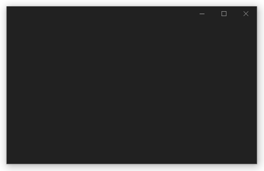

# FxStage

[  ](https://search.maven.org/artifact/io.github.micheljung/fxstage)


A small library to create borderless JavaFX stages with native window behaviour.

## Features

* Borderless UI
* Native window behavior on Windows 10/11
  * Drop shadow
  * Window resizing
  * Aero Snap
* Native window behavior on Linux (GTK 3, X11/XWayland)
  * Moving, resizing, maximizing and edge tiling are done by the window manager
  * Keyboard shortcuts of the window manager (e.g. Super+Arrow) work
* Fallback to cross-platform Windows 10 imitation (e.g. on macOS)
* Minimally-invasive
* Fully customizable

## Screenshot



## Usage

Convert an existing stage:

```
FxStage.configure(stage).apply();
```

## Get It Now

Get it via https://search.maven.org/artifact/io.github.micheljung/fxstage

```
repositories {
  mavenCentral()
}

dependencies {
  implementation 'io.github.micheljung:fxstage:0.8.4'
}
```

## Important

* The API is not yet polished and might change in future
* Cross-platform Windows 10 imitation is yet buggy
* On Linux, the drop shadow requires a compositing window manager
* On Linux with JavaFX on the module path, FxStage finds the native window most reliably if you add these JVM arguments:
  ```
  --add-exports javafx.graphics/com.sun.javafx.stage=fxstage
  --add-opens javafx.graphics/com.sun.javafx.tk.quantum=fxstage
  --add-exports javafx.graphics/com.sun.glass.ui=fxstage
  ```
  Use `ALL-UNNAMED` instead of `fxstage` (its automatic module name) if FxStage is on the class path.
* Requires Java 11+

# Other projects

Also check out https://github.com/micheljung/jfx-waitomo-theme
